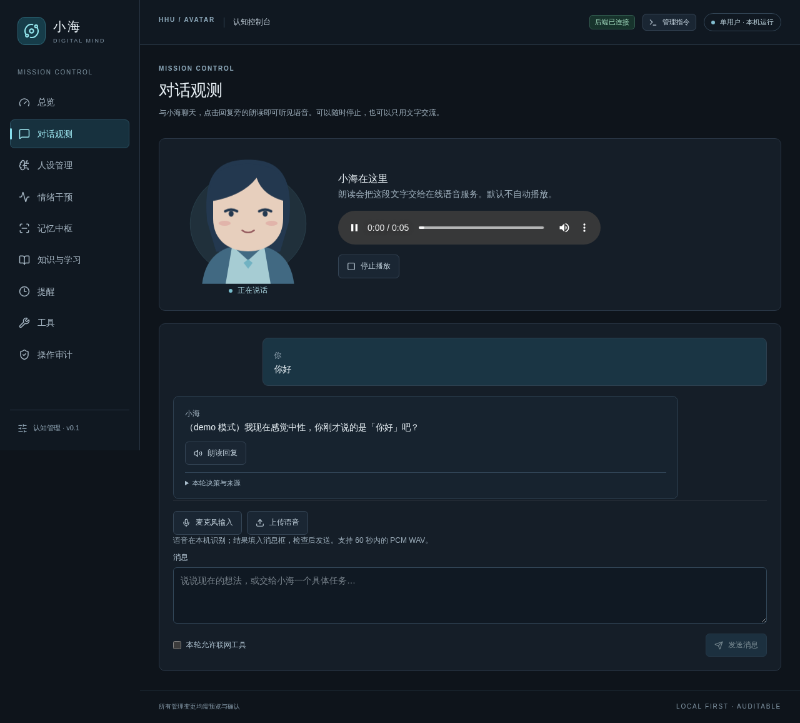

# 网页语音与最小角色形象：阶段总结

日期：2026-11-10；作者：spinner-bot；开发起点：`c488008`。完整证据见 [验证记录](验证记录.json)、[进展日志](进展.md)、[推进计划](推进计划.md)。

## 交付结果

项目从可观测文本后台推进到可在浏览器听见、看见的最小角色交互。网页按需朗读真实 Edge-TTS 回复音频，按音频播放时钟驱动口型，用情绪决策控制语速、音调与表情；同时接入可选麦克风和 WAV 转写草稿。真实 TTS/浏览器播放已验收，真实 ASR 与物理设备仍待验收。

| 环节 | 本轮交付 | 验收边界 |
|---|---|---|
| 思 → 声 | 独立朗读 API，情绪参数传递，MP3 鉴权读取 | 真实 Edge-TTS 通过；真实 LLM 质量未在本轮重评 |
| 声 → 演 | 音频解码、时间戳口型、SVG 形象、播放/暂停/停止/拖动进度 | Chromium 真实播放通过；中文元音准确率与延迟未量化 |
| 听 → 思 | AudioWorklet 录音、WAV 上传、可选本机识别、回填草稿后手动发送 | 真实浏览器采集通过；识别使用固定测试引擎，未运行真实 ASR 模型 |
| 资源与故障 | 30 秒 TTS 超时，音频缓存限额/过期，取消迟到响应，卸载释放麦克风与音频 | 上游生成尚不能真正取消；多日稳定性未验证 |
| 运行 | 本机健康检查、端口配置/冲突提示、断开连接容错 | 健康检查只代表进程响应；未配置进程守护 |
| 工程资料 | 补齐会话锁合并遗漏，隔离验证环境，更新当前文档与历史描述 | 没有训练新模型、没有访问用户运行库或使用 GPU |

## 验证结果

- Python 全量：**589 passed, 1 skipped**；唯一跳过为未安装 torch 的可选测试。使用工作区内 `--basetemp`，满足实验导出目录边界。
- 前端组件：**25 passed**；类型、lint、生产构建通过。
- Chromium 离线流程：**9 passed**，包含五项原管理流程与四项语音流程。
- 真实 Edge-TTS 浏览器流程：**1 passed**，最终复核耗时 8.2 秒；覆盖 MP3 实际播放、按播放时钟驱动口型、暂停闭嘴和停止。
- 独立真实 TTS 探测：合成/分析 4.11 秒，MP3 32976 字节、时长 5.496 秒、口型 548 帧，无解码降级。
- 模拟麦克风经真实 AudioWorklet 生成 WAV，识别草稿未自动发送；空音频、错误格式、截断、超限、识别失败与取消迟到结果有独立验证。
- 客户端中途 RST 断开、服务继续响应与端口占用有专项验证；测试使用临时数据库。

## 使用与证据

[完整运行说明](../../网页语音与最小形象.md)。启动后进入“对话观测”，发送文字并点击“朗读回复”。语音识别默认关闭；指定已准备的本机模型目录后启用，转写不会自动发消息。

[窄屏截图](browser-mobile.png)；截图来自真实 TTS 浏览器验收，文字回复使用离线规则模式。原始运行音频在忽略目录 `data/speech-demo/`，未提交个人音频或用户数据库。

## 下一阶段推进策略

| 优先级 | 工作 | 放行依据 |
|---|---|---|
| P0 | 目标设备真实中文 ASR、物理麦克风、静音/噪声/拒绝权限测试 | 记录识别错误、延迟和误发送为零，草稿确认路径保持可用 |
| P1 | 用独立中文语料量化嘴型、音画延迟和听感，校准 LPC/静音与平滑 | 量化结果优于当前基线，再调整算法 |
| P1 | 流式模型输出、分段 TTS、真正上游取消与打断 | 中断不会重复写入记忆/提醒，不播放过时片段 |
| P1 | 多日运行、超时/断网/进程重启，增加进程管理与演示脚本 | 可重复启动，故障保留文字与已确认数据 |
| P2 | 记忆归属/任务交付独立评测，之后再选择模型、提示或训练 | 使用未参与调试的独立样本，与现有后台保持同条件对照 |
| P2 | 美术与正式 Live2D/Godot/VRM 适配 | 复用现有时间轴协议，先证明交互质量与资源预算 |

不将工程测试数作为陪伴质量分数；不把可选 ASR 接口或最小 SVG 形象写成全部远期目标已完成。

## 版本记录

- `143868f` docs(plan): define speech and browser avatar milestones
- `531bb2c` fix(web): initialize shared session lock after integration
- `5081391` feat(speech): serve authenticated audio and emotion driven lip timelines
- `4037b07` feat(avatar): play speech with clock synced browser character
- `e5851eb` feat(asr): add opt in local WAV transcription without automatic actions
- `c53758e` feat(voice): capture microphone audio and review transcripts before sending
- `cba293d` test(voice): verify playback lip sync and microphone flows in Chromium
- `abc7d56` fix(runtime): handle cancelled clients and expose local process health

所有本轮实现提交作者为 spinner-bot，文档与截图另以独立提交归档。
